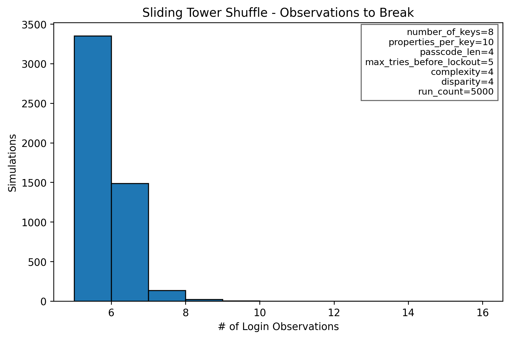
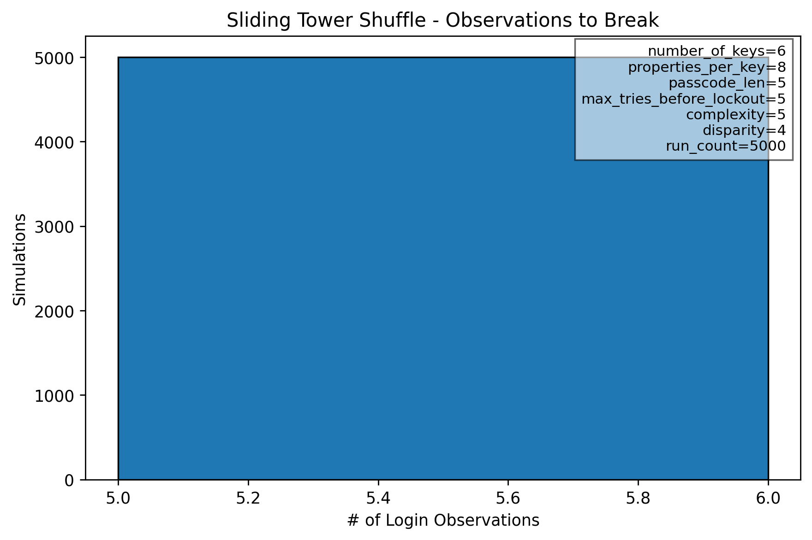

# Sliding Tower Shuffle Benchmarks

This repo focuses on the Sliding Tower shuffle policy for nKode keypads and how many observations are needed to crack a passcode. The goal is to explain how the shuffle works and to visualize the distribution of observations required to break a code under different parameter settings.

## Sliding Tower Shuffle Explained

The keypad is modeled as a `k x p` matrix where:
- `k` is the number of keys (rows).
- `p` is the number of properties per key (columns).

Each shuffle applies two steps:
1. **Tower selection (column subset):** `TowerShuffle` maintains two towers of column indices. Each shuffle splits every tower floor into a “keep” and “discard” half, swaps the discards between towers, and rebuilds the floors. The indices in the left tower define which columns will be shuffled next.
2. **Row shift on selected columns:** `SlidingTowerShuffleKeypad` chooses a random cyclic shift of the rows and applies it only to the columns selected by the left tower. Other columns stay fixed for that shuffle.

This produces a controlled, sliding subset of column shuffles rather than a full random permutation every time.

Relevant implementation files:
- `src/keypad/tower_shuffle.py`
- `src/keypad/keypad.py`

## Histogram Scenarios

The histograms below compare Sliding Tower settings across several keypad/passcode configurations. The values reflect the number of observations needed to break the nKode under each configuration.

### Scenario Parameters

Definitions:
- **Keys (`k`)**: number of keys (rows) on the keypad.
- **Props (`p`)**: number of properties/icons per key (columns).
- **Passcode Len**: length of the passcode in key entries.
- **Complexity**: minimum number of distinct within-key positions used in the passcode (e.g., prevents using only the upper-left position across keys).
- **Disparity**: minimum number of unique property icons used in the passcode (how many distinct properties appear).
- **Runs**: number of Monte Carlo trials used for each histogram.

| Scenario | Keys (`k`) | Props (`p`) | Passcode Len | Complexity | Disparity | Runs |
| --- | --- | --- | --- | --- | --- | --- |
| baseline_k6_p8 | 6 | 8 | 4 | 4 | 4 | 5000 |
| short_passcode_k6_p8 | 6 | 8 | 3 | 3 | 3 | 5000 |
| dense_keypad_k8_p10 | 8 | 10 | 4 | 4 | 4 | 5000 |
| longer_passcode_k6_p8 | 6 | 8 | 5 | 5 | 4 | 5000 |

## Histograms (Observations to Break)

If the images do not render in your viewer, open the `hist/` directory directly.

### Baseline

### Short passcode

### Dense keypad

### Longer passcode

## Conclusion

Across these Sliding Tower scenarios, the only parameter that changes the number of observations needed to crack the nKode is the number of properties per key. With 8 icons per key, it consistently takes exactly 5 contiguous observations to break the code.
